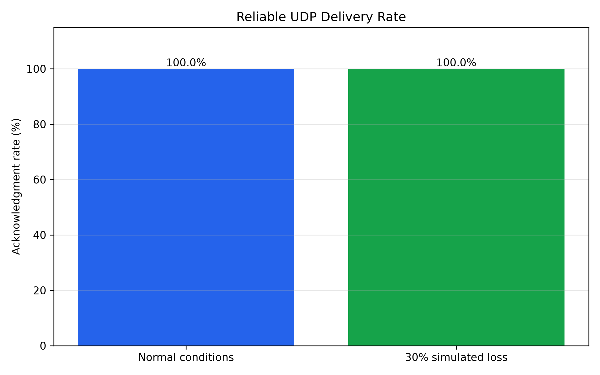
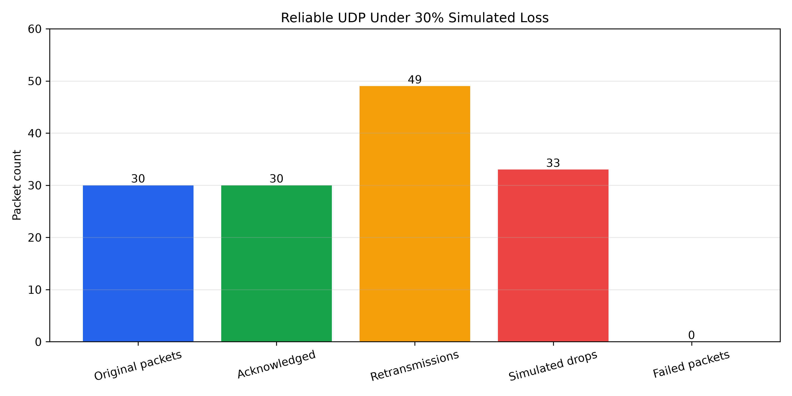
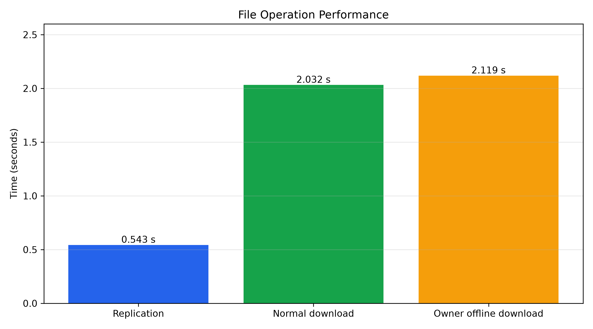
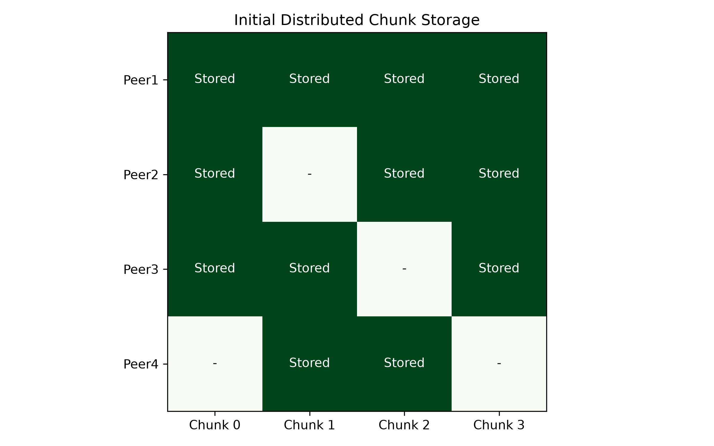
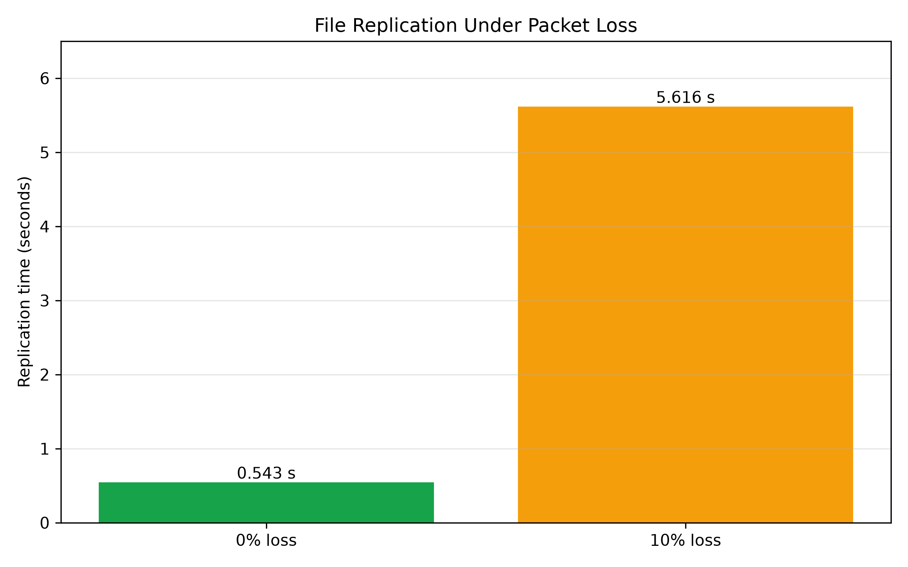
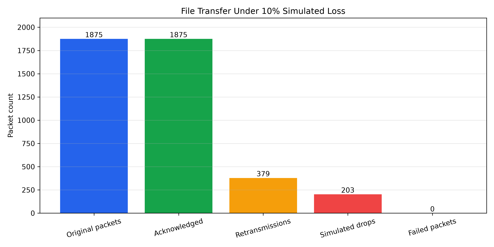

# RPGP — Reliable Peer Group Protocol

A decentralized, multi-party group communication and distributed file-sharing application implemented in Python using UDP sockets.

## Project Overview

RPGP provides peer-to-peer communication without requiring a central server. Every participant acts as both a client and a server. The application implements reliability mechanisms at the application layer to overcome the limitations of UDP.

## Features

- Decentralized peer-to-peer architecture
- Support for four or more peers
- Automatic peer discovery and membership management
- Real-time group chat
- Custom binary UDP protocol
- Packet sequence numbers and acknowledgments
- Automatic retransmission
- Duplicate packet detection
- Sliding-window flow control
- Heartbeat-based peer failure detection
- Distributed file sharing
- File chunking and UDP fragmentation
- Remote chunk replication
- Out-of-order fragment reassembly
- SHA-256 integrity verification
- File retrieval after original owner failure
- Simulated packet loss testing
- Experimental performance visualization

## Technologies Used

- Python 3
- UDP sockets
- Multithreading
- SHA-256 hashing
- Matplotlib
- Ubuntu WSL
- Git and GitHub

## Project Structure

```text
udp_p2p_project/
├── main.py
├── config.py
├── protocol.py
├── membership.py
├── reliable_udp.py
├── chat.py
├── file_manager.py
├── replication.py
├── downloader.py
├── file_service.py
├── metrics.py
├── requirements.txt
├── README.md
├── .gitignore
├── docs/
│   └── PROTOCOL.md
├── tests/
│   └── test_protocol.py
└── results/
    ├── chunk_distribution.png
    ├── delivery_rate.png
    ├── file_performance.png
    ├── packet_loss_recovery.png
    ├── file_loss_comparison.png
    ├── file_loss_statistics.png
    └── experiment_results.csv
```

## Installation

Clone the repository:

```bash
git clone https://github.com/archerm100/UDP-P2P-Group-Communication.git
cd UDP-P2P-Group-Communication
```

Create and activate a virtual environment:

```bash
python3 -m venv venv
source venv/bin/activate
pip install -r requirements.txt
```

## Running the Application

Open four separate Ubuntu terminals inside the project directory.

### Peer 1

```bash
python3 main.py --name Peer1 --port 5001
```

### Peer 2

```bash
python3 main.py --name Peer2 --port 5002 --bootstrap 5001
```

### Peer 3

```bash
python3 main.py --name Peer3 --port 5003 --bootstrap 5001
```

### Peer 4

```bash
python3 main.py --name Peer4 --port 5004 --bootstrap 5001
```

The bootstrap peer assists with initial peer discovery. It is not required for ongoing communication between connected peers.

## Available Commands

| Command | Description |
|---|---|
| peers | Display active peers |
| chat message | Send a group message |
| share path | Share and replicate a file |
| files | List available shared files |
| chunks | Display locally stored chunks |
| download filename | Download a shared file |
| stats | Display reliability statistics |
| help | Display available commands |
| exit | Leave the network |

## File Sharing Demonstration

Create a sample file before starting the peers:

```bash
mkdir -p shared
dd if=/dev/urandom of=shared/sample.bin bs=1024 count=1024
```

Share the file from Peer1:

```text
share shared/sample.bin
```

Download it from another peer:

```text
download sample.bin
```

The application retrieves missing chunks, reconstructs the file and verifies its SHA-256 hash.

## Protocol Configuration

| Parameter | Value |
|---|---|
| Transport protocol | UDP |
| Maximum packet size | 1200 bytes |
| Header size | 34 bytes |
| Maximum payload | 1166 bytes |
| Sliding window | 32 packets per destination |
| Retransmission timeout | 0.5 seconds |
| Maximum retries | 20 |
| Heartbeat interval | 2 seconds |
| Peer timeout | 6 seconds |
| File chunk size | 256 KiB |
| Remote replication factor | 2 |

## Experimental Results

The application was tested using four simultaneous peers on Ubuntu WSL.

| Experiment | Observed result |
|---|---|
| Four-peer discovery | Successful |
| Group chat | Successful |
| Normal chat acknowledgment rate | 100% (3/3) |
| Chat acknowledgment rate under 30% simulated loss | 100% (30/30) |
| Retransmissions during loss test | 49 |
| Simulated drops recorded by sender | 33 |
| Failed packets during loss test | 0 |
| Test file size | 1 MiB |
| Confirmed remote chunk replicas | 8/8 |
| File replication time | 0.543 seconds |
| File replication acknowledgments | 1875/1875 |
| Normal download and reconstruction time | 2.032 seconds |
| Download after owner failure | 2.119 seconds |
| End-to-end file integrity | SHA-256 verified |

## Performance Graphs

### Reliable UDP Delivery Rate



### Packet Loss and Retransmission



### File Operation Performance



### Distributed Chunk Storage



To regenerate the graphs from the recorded experimental measurements:

```bash
python3 metrics.py
```

## Fault Tolerance

The application was tested by forcefully terminating the original bootstrap peer. The remaining peers automatically detected its failure through heartbeat timeouts and continued communicating.

A separate file-sharing experiment demonstrated successful file reconstruction from surviving peers after the original file owner was terminated.

The downloaded file was independently verified using SHA-256 hashing.

## Current Limitations

- Network experiments were conducted on localhost using Ubuntu WSL.
- Chat messages may arrive out of order during packet loss.
- File metadata must fit within a single UDP payload.
- Automatic replacement of lost replicas is not implemented.
- Existing file catalogs are not automatically synchronized with late-joining peers.
- Performance graphs use recorded experimental measurements.
- Performance measurements are based on individual localhost experiments, not repeated statistical trials.
- Communication is not encrypted or authenticated.

## Future Improvements

- Multi-machine network support and testing
- Automatic replica repair
- Ordered chat delivery
- Dynamic file catalog synchronization
- Fragmented metadata transmission
- Live performance monitoring
- Encryption and peer authentication
- Graphical user interface


## File Transfer Under Simulated Packet Loss

A 1 MiB file was replicated across four peers
under normal conditions and 10% simulated
packet loss.

| Metric | 0% Loss | 10% Loss |
|---|---:|---:|
| Original packets | 1875 | 1875 |
| Acknowledged packets | 1875 | 1875 |
| Retransmissions | 0 | 379 |
| Sender-recorded drops | 0 | 203 |
| Failed packets | 0 | 0 |
| Pending packets | 0 | 0 |
| Confirmed remote replicas | 8/8 | 8/8 |
| Replication time | 0.543 s | 5.616 s |
| Acknowledgment rate | 100% | 100% |

The receiving peer successfully downloaded
the file under simulated packet loss in
2.019 seconds. All four chunks were available
and SHA-256 verification succeeded.

### Replication Time Comparison



### File Transfer Recovery Statistics




## Conclusion

RPGP demonstrates how reliable group communication and distributed file sharing can be implemented over UDP without a centralized server. Experimental results verify packet loss recovery, peer failure detection, distributed replication and file integrity verification.


## Contributors

| Name | GitHub |
|---|---|
| Saad Younas | [archerm100](https://github.com/archerm100) |
| Talha Saeed | [Talha2218](https://github.com/Talha2218) |

### Academic Information

- University: NUST College of Electrical & Mechanical Engineering
- Department: Computer & Software Engineering
- Course: EC-330 Computer Networks
- Instructor: Muhammad Umar Farooq

